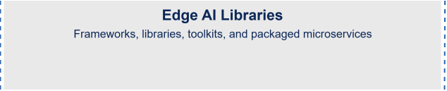

# Accelerate AI with Open Edge Platform

An open source platform for developing highly-optimized and scalable AI solutions for the edge. It focuses on high-performance inference, ease of integration, and efficient utilization of Intel hardware.

  

  

  

* Reference Applications designed to accelerate the development of AI solutions tailored to specific use cases:

  * [Metro](https://github.com/open-edge-platform/metro-ai-suite/)
  * [Manufacturing](https://github.com/open-edge-platform/manufacturing-ai-suite)
  * [Retail](https://github.com/open-edge-platform/retail-ai-suite)
  * [Robotics](https://github.com/open-edge-platform/robotics-ai-suite)
  * [Education](https://github.com/open-edge-platform/education-ai-suite)
  * [Health and Life Sciences](https://github.com/open-edge-platform/health-and-life-sciences-ai-suite)
  * [Federal and Aerospace](https://github.com/open-edge-platform/federal-and-aerospace-ai-suite)
    
* [Edge AI Libraries and Tools](https://github.com/open-edge-platform/edge-ai-libraries) help to build high-performance 
  Vision, Generative, and Physical AI applications.
* [Edge Pack](https://github.com/open-edge-platform/edge-pack) is a curated collection of Intel-validated software packages and drivers that 
  unlock specific Intel platform capabilities. 
* [Edge Workloads and Benchmarks](https://github.com/open-edge-platform/edge-workloads-and-benchmarks) 
  are performance-optimized pipelines for validating media
  and edge AI analytics.

Explore the Open Edge Platform [documentation](https://docs.openedgeplatform.intel.com) to learn more about its components, or use the [documentation AI assistant](https://docs.openedgeplatform.intel.com/2026.2/index.html?chat) to ask questions about the platform.

Unless otherwise noted, the platform repositories are released under the Apache License 2.0.
