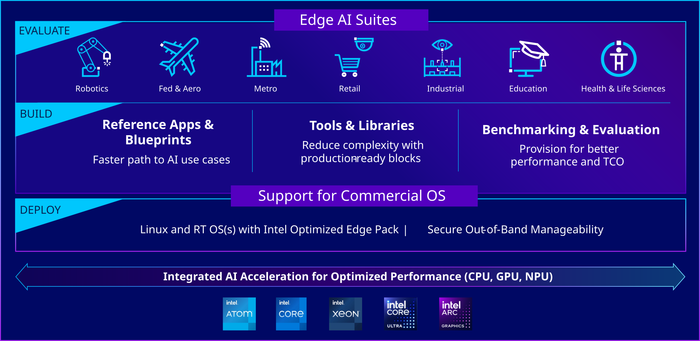

# Open Edge Platform

**Build, optimize, and deploy AI at the edge.**

Open Edge Platform is an open-source platform for building highly optimized and scalable edge AI solutions on Intel hardware.

 

 
  <a href="#"> 
     
  </a> 

 

 

## Not sure where to begin?

Try [**agent skills**](https://github.com/open-edge-platform/skills), explore [**the documentation**](https://docs.openedgeplatform.intel.com/2026.2/index.html) or ask [**chatbot**](https://docs.openedgeplatform.intel.com/2026.2/index.html?chat=) a question to build solutions with Open Edge Platform.

## Edge AI Suites

Start with reference applications, libraries, and tools curated for real-world industry use cases

| AI Suite | Build solutions for |
|---|---|
| [**Metro**](https://github.com/open-edge-platform/metro-ai-suite) | Smart cities, transportation, safety, security, and video analytics |
| [**Manufacturing**](https://github.com/open-edge-platform/manufacturing-ai-suite) | Predictive maintenance, anomaly and defect detection, and worker safety |
| [**Retail**](https://github.com/open-edge-platform/retail-ai-suite) | Self-checkout, order accuracy, loss prevention |
| [**Robotics**](https://github.com/open-edge-platform/robotics-ai-suite) | Humanoid, autonomous mobile, stationary arm robots, perception, real time control |
| [**Education**](https://github.com/open-edge-platform/education-ai-suite) | Smart classroom, teaching assistance |
| [**Health & Life Sciences**](https://github.com/open-edge-platform/health-and-life-sciences-ai-suite) | Multimodal patient monitoring, endoscopic detection, ultrasound tumor segmentation |
| [**Federal & Aerospace**](https://github.com/open-edge-platform) | Handheld soldier systems, uncrewed aerial vehicle, mission decision support |

### Libraries, Tools and Services

Build high-performance Vision, Generative, and Physical AI applications with [tools and frameworks](https://github.com/open-edge-platform/edge-ai-libraries) optimized for Intel.

| **Vision AI** | **Generative AI** | **Physical AI** |
|---|---|---|
| **Build real-time vision pipelines** | **Run generative and multimodal AI workloads at the edge** | **Build AI systems that perceive and act in the physical world** |
| • Run detection, segmentation, tracking, and anomaly detection pipelines on edge systems. • Enable object localization, free-space understanding, obstacle awareness, and visual inspection. | • Run local language model pipelines for command understanding and planning. • Enable intent decomposition, workflow sequencing, and tool or API orchestration. | • Run closed-loop pipelines that turn camera and machine-state observations into action. • Enable learned manipulation and autonomous task execution on physical systems. |

**Popular Open Edge Platform tools**

| Tool | What it does |
|---|---|
| [Anomalib](https://github.com/open-edge-platform) | Train and deploy visual anomaly detection models |
| [Geti™](https://github.com/open-edge-platform) | Build, train, optimize, and run computer vision models |
| [Datumaro](https://github.com/open-edge-platform) | Build, analyze, transform, and manage computer vision datasets |
| [DL Streamer](https://github.com/open-edge-platform) | Build streaming media analytics pipelines |
| [SceneScape](https://github.com/open-edge-platform) | Build multimodal object tracking and scene analytics |
| [Physical AI Studio](https://github.com/open-edge-platform) | Train robots from human demonstrations |
| [ViPPET](https://github.com/open-edge-platform/edge-ai-libraries/tree/main/tools/visual-pipeline-and-platform-evaluation-tool) | Get actionable insights that support optimized hardware selection and performance tuning |

### Optimize AI inference

The Open Edge Platform enables and integrates industry-standard solutions, such as [PyTorch](https://docs.pytorch.org/docs/main/notes/get_start_xpu.html) and [OpenVINO™](https://docs.openvino.ai/2026/index.html) to optimize AI inference across Intel® CPUs, GPUs, and NPUs. [Find out all the frameworks enabled](https://docs.openedgeplatform.intel.com/dev/edge-ai-libraries/edge-ai-frameworks.html)

### Build an edge software platform

Use [Edge Pack](https://github.com/open-edge-platform/edge-pack) – a set of modular platform software packages – to enable key functionality for your operating system, including graphics, media, edge AI, networking, and manageability

Use performance-optimized [Edge workloads and benchmarks](https://github.com/open-edge-platform/edge-workloads-and-benchmarks) to evaluate media and AI analytics on edge systems.

## Documentation

Check the [documentation](https://docs.openedgeplatform.intel.com/2026.2/index.html) to find getting started and installation guides, architecture and configuration instructions, system requirements and release notes, or uses the [documentation AI assistant](https://docs.openedgeplatform.intel.com/2026.2/index.html) to ask questions about Open Edge Platform.

## Contributing

The Open Edge Platform is built in the open. You can participate by reporting issues and proposing enhancements. Check the CONTRIBUTING.md file in the repository you want to work with for contribution guidance.

## License

Unless otherwise noted in an individual repository, Open Edge Platform repositories are released under the **Apache License 2.0**.
